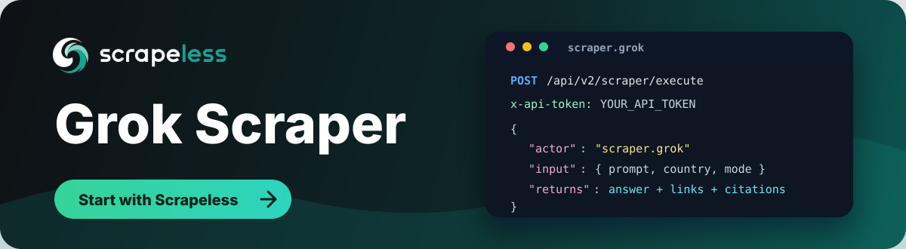

# Grok Scraper

<p align="center">
  <a href="https://app.scrapeless.com/passport/login?redirect=/quick-start&utm_source=github&utm_medium=repo&utm_campaign=grok_scraper" target="_blank">
    
  </a>
</p>

<p align="center">
  <a href="https://app.scrapeless.com/passport/login?redirect=/quick-start&utm_source=github&utm_medium=repo&utm_campaign=grok_scraper">
    
  </a>
  <a href="https://www.scrapeless.com/en/blog?utm_source=github&utm_medium=repo&utm_campaign=grok_scraper">
    
  </a>
  <a href="https://x.com/Scrapelessteam">
    
  </a>
  <a href="https://www.linkedin.com/company/scrapeless/">
    
  </a>
</p>

Collect xAI Grok answers through the **Scrapeless AI Scraper** API, including the full response text, follow-up suggestions, web search results, X (Twitter) search results, and source footnotes, without reverse-engineering the Grok UI, maintaining browsers, or building your own anti-blocking stack.

Use this repo when you need a repeatable way to monitor Grok answers for GEO and AI search visibility, compare prompts across regions, audit cited sources and X search results, or pipe AI responses into analytics and automation workflows.

- **Full documentation:** https://docs.scrapeless.com/en/llm-chat-scraper/quickstart/introduction/
- **Get your `x-api-token`:** https://app.scrapeless.com/passport/login?redirect=/quick-start
- **API endpoint:** `POST https://api.scrapeless.com/api/v2/scraper/execute`

## How it works

Send a single `POST` request to the Scrapeless endpoint with your API token in
the `x-api-token` header. The body specifies the actor (`scraper.grok`) and
an `input` object with your prompt and options. The API runs the query and
returns the structured result in `task_result`.

```http
POST https://api.scrapeless.com/api/v2/scraper/execute
Content-Type: application/json
x-api-token: <YOUR_API_TOKEN>
```

## Quick start (curl)

```bash
curl 'https://api.scrapeless.com/api/v2/scraper/execute' \
  --header 'Content-Type: application/json' \
  --header 'x-api-token: YOUR_API_TOKEN' \
  --data '{
    "actor": "scraper.grok",
    "input": {
      "prompt": "Most reliable proxy service for data extraction",
      "country": "US",
      "mode": "MODEL_MODE_AUTO"
    }
  }'
```

To receive the result asynchronously, add a `webhook` object:

```json
"webhook": { "url": "https://www.your-webhook.com" }
```

## Request parameters

The request body has three top-level fields: `actor` (always `scraper.grok`),
`input` (below), and an optional `webhook`.

| Parameter (`input.*`) | Type   | Required | Description                                                                    |
| --------------------- | ------ | -------- | ------------------------------------------------------------------------------ |
| `prompt`              | string | Yes      | Prompt to send to Grok.                                                        |
| `country`             | string | Yes      | Country / region code (e.g. `US`, `JP`).                                       |
| `mode`                | string | Yes      | Model mode: `MODEL_MODE_FAST`, `MODEL_MODE_EXPERT`, or `MODEL_MODE_AUTO`.      |

## Response

A successful call returns a status envelope; the scraped data lives in
`task_result`:

```json
{
  "status": "success",
  "task_id": "e705743d-da2e-4163-9ccd-eef62529ff72",
  "task_result": {
    "conversation": {
      "conversation_id": "...",
      "title": "...",
      "create_time": "...",
      "modify_time": "...",
      "temporary": false
    },
    "user_query": "Most reliable proxy service for data extraction",
    "user_model": "grok-4",
    "full_response": "...answer text...",
    "follow_up_suggestions": [],
    "web_search_results": [
      { "title": "...", "url": "https://...", "preview": "..." }
    ],
    "x_search_results": [
      { "user_name": "...", "name": "...", "text": "...", "url": "https://..." }
    ],
    "tool_usages": [],
    "footnotes": {}
  }
}
```

### Top-level fields

| Field         | Type   | Description                                    |
| ------------- | ------ | ---------------------------------------------- |
| `status`      | string | Request status, e.g. `success`.                |
| `task_id`     | string | Unique identifier for the task.                |
| `task_result` | object | Scraped result (fields below).                 |

### `task_result` fields

| Field                   | Type     | Description                                                          |
| ----------------------- | -------- | ------------------------------------------------------------------- |
| `conversation`          | object   | Conversation metadata (`conversation_id`, `title`, `create_time`, `modify_time`, `temporary`). |
| `user_query`            | string   | Original prompt.                                                    |
| `user_model`            | string   | Model used, e.g. `grok-4`.                                          |
| `full_response`         | string   | The answer text from Grok.                                          |
| `follow_up_suggestions` | []string | Suggested follow-up questions.                                      |
| `web_search_results`    | array    | Web search results (`title`, `url`, `preview`).                     |
| `x_search_results`      | array    | X (Twitter) search results (`user_name`, `name`, `text`, `url`, `post_id`, `view_count`, `create_time`, `profile_image_url`). |
| `tool_usages`           | array    | Tools invoked while answering (`tool_name`, `tool_args`, `card_id`). |
| `footnotes`             | object   | Footnotes keyed by ID; each is an object with `id`, `card_type`, `url`. |

For the complete field list (nested conversation, footnote, and X search
attributes), see the [official documentation](https://docs.scrapeless.com/en/llm-chat-scraper/quickstart/introduction/).

## Code examples

Ready-to-run examples live in [`examples/`](./examples):

| Language | File                                       | Run                                   |
| -------- | ------------------------------------------ | ------------------------------------- |
| Python   | [`example.py`](./examples/example.py)      | `pip install requests && python example.py` |
| Node.js  | [`example.js`](./examples/example.js)      | `node example.js` (Node 18+)          |
| Go       | [`example.go`](./examples/example.go)      | `go run example.go`                   |
| Java     | [`Example.java`](./examples/Example.java)  | `java Example.java` (Java 11+)        |
| PHP      | [`example.php`](./examples/example.php)    | `php example.php`                     |

All examples read the token from the `SCRAPELESS_API_TOKEN` environment variable:

```bash
export SCRAPELESS_API_TOKEN="your_api_token"
```

## Practical use cases

### AI answer monitoring

Track how Grok responds to your brand, product category, documentation topics, or competitor prompts. Store the full response text, web search results, X search results, and footnotes so your team can measure AI visibility over time.

### GEO and SEO research

Run the same prompt across countries and model modes to compare which sources Grok cites, how recommendations change by region, and where your content appears in AI-generated answers.

### Competitor intelligence

Collect structured Grok answers for competitor names, feature comparisons, pricing questions, and "best tool for..." prompts. Use the output, including X (Twitter) search results, to identify messaging gaps and content opportunities.

### Dataset and workflow automation

Pipe Grok answers into internal dashboards, knowledge-base QA systems, spreadsheets, data warehouses, or alerting workflows through the synchronous API response or webhook callback.

## Why use Scrapeless for Grok scraping?

| Benefit | What it means for your team |
| ------- | --------------------------- |
| One unified API | Query Grok through the same Scrapeless AI Scraper workflow used for other AI answer engines. |
| Structured output | Receive the full response text, follow-up suggestions, web and X search results, footnotes, and prompt metadata in a developer-friendly response. |
| Less maintenance | Avoid building browser automation, UI selectors, proxy rotation, retries, and anti-blocking logic yourself. |
| Region-aware analysis | Use country inputs to compare localized AI answers and source citations. |
| Production integration | Use API tokens, webhooks, and language examples to connect Grok data to real applications quickly. |

## FAQ

### What is Grok Scraper?

Grok Scraper is a Scrapeless AI Scraper actor that sends prompts to xAI Grok and returns structured answer data, including the full response text, follow-up suggestions, web search results, X (Twitter) search results, and source footnotes.

### Do I need to run a browser or proxy pool?

No. This repo shows how to call the Scrapeless API. Scrapeless handles the scraping workflow behind the API, so your application only needs to send requests and process the returned data.

### Which Grok modes are supported?

The current request schema supports `MODEL_MODE_FAST`, `MODEL_MODE_EXPERT`, and `MODEL_MODE_AUTO`. Check the official documentation for the latest supported options before deploying a production workflow.

### Can I get results asynchronously?

Yes. Add a `webhook` object with your callback URL to receive results asynchronously when the task completes.

### Is this suitable for AI search visibility monitoring?

Yes. The response includes the full answer text, web search results, X (Twitter) search results, and footnotes, which makes it useful for GEO analysis, brand monitoring, source tracking, and competitive research.

### What should I consider before using AI scraping in production?

Make sure your use case complies with applicable laws, platform terms, privacy requirements, and your organization's data policies. Avoid collecting sensitive, private, or unauthorized information.

## Learn more

- [Scrapeless AI Scraper documentation](https://docs.scrapeless.com/en/llm-chat-scraper/quickstart/introduction/)
- [Supported AI Scraper actors](https://docs.scrapeless.com/en/llm-chat-scraper/quickstart/introduction/)
- [Scrapeless dashboard](https://app.scrapeless.com/passport/login?redirect=/quick-start)
- [Scrapeless website](https://www.scrapeless.com/en)

## Contact us

Need help building a Grok monitoring workflow or scaling AI answer collection?

- Join our [Discord](https://discord.gg/VU2vtbq7Q2).
- Contact us on [Telegram](https://t.me/scrapeless).
- For repo-specific issues or improvements, open an issue or pull request in this repository.
